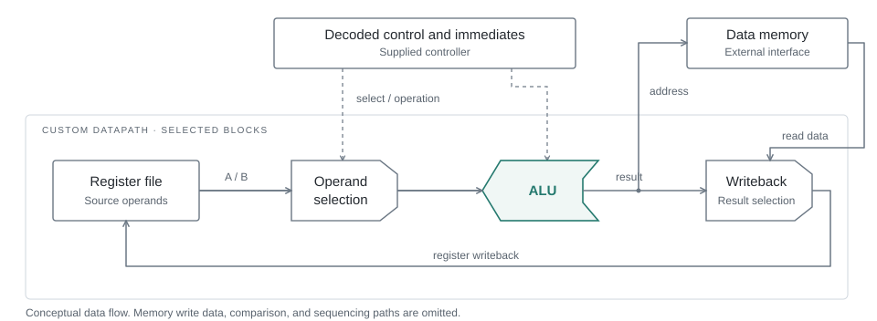

# RV32I Datapath · From Transistors to Physical Integration

**UIUC ECE 425 · Spring 2026 · Portfolio review draft**

A study in the physical implementation of a 32-bit, bit-sliced RISC-V datapath: custom cell design, hierarchical schematic/layout construction, and integration with an automatically placed-and-routed controller.

> Private review copy. Public release requires course-sharing clearance and final author approval. Ayush Jain confirms sole authorship of the student implementation. This repository contains newly written documentation and conceptual diagrams; course solutions, native EDA databases, technology libraries, and design images are excluded.

## Engineering focus

- **Cell-to-system hierarchy:** saved custom-cell views feed arithmetic, storage, multiplexing, and comparison blocks.
- **Bit-sliced organization:** the course architecture composes 32 one-bit slices into a datapath, making repeated placement and inter-slice routing central design concerns.
- **Physical integration:** saved artifacts cover a controller, a standard-cell CPU, and a CPU variant using a register-file macro.
- **Evidence discipline:** saved design views and screenshots establish artifact existence. They do not establish functional correctness, timing closure, or fabrication readiness.

## What is supported by the archive?

| Scope | Evidence inspected | Claim supported |
|---|---|---|
| Custom datapath | Native schematic/layout files for datapath, bitslice, ALU, register file, and supporting cells | Design artifacts exist; connectivity and correctness require licensed-tool review |
| Shift extension | Separate shifted datapath and bitslice views plus shifter cells | Extension artifacts exist; shift instruction tests are not confirmed |
| Physical integration | Controller/CPU saved databases and four screenshots | Physical-design work is archived; the integration screenshot was visually inspected |
| DRC | Two saved Innovus geometry reports report no violations | Historical tool reports only; exact database association and full signoff remain unverified |
| Timing | An archived report warns of a timing loop and a cut arc | Timing closure must not be claimed |
| Simulation / LVS | Course infrastructure exists; no conclusive datapath pass record located in the initial audit | No passing result claimed |

## Explore

| Document | Contents |
|---|---|
| [Architecture](docs/architecture.md) | Conceptual datapath, implementation hierarchy, and interfaces |
| [Implementation](docs/implementation.md) | Custom design and physical integration stages |
| [Verification](docs/verification.md) | Evidence, limitations, and missing checks |
| [Reproducibility](docs/reproducibility.md) | What can be inspected here and what needs authorized tools |
| [Attribution](ATTRIBUTION.md) | Course reference design, student work, and pending ownership review |
| [Release review](docs/release-review.md) | Requirements before a public release |

No area, frequency, power, transistor-count, benchmark, silicon, or complete RV32I compliance claim is made. The course target excludes system/fence operations and treats shift support as an extension. The ISA is the architectural context, not proof of full processor compliance.
