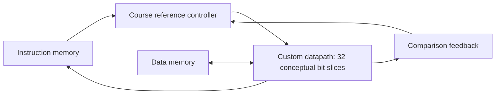

# Architecture and design boundaries

The course target is a single-cycle 32-bit datapath with separate instruction and data memory ports. A controller supplies decoded control and immediates. The archive contains custom datapath views; the SystemVerilog processor architecture and controller originated in course-provided material.

This is a newly drawn functional overview, not an extracted netlist or an exact wiring diagram. Memory timing is an assumption of the course environment, not a real memory-system performance claim.

## Blocks represented in the saved hierarchy

| Block | Intended role | Archive observation |
|---|---|---|
| Register file | Source operands and destination writeback | Schematic/layout views and later macro exchange files |
| ALU and adder | Arithmetic and logical operations | Separate ALU and adder cells |
| Comparator | Branch and set-less-than feedback | Comparator cell |
| PC / register storage | Instruction sequencing and state | Register and top-level datapath cells |
| Multiplexers | Operand, memory, and writeback selection | Multi-input mux cells |
| Shift extension | Shift operations across slices | Shifter and separate shifted hierarchy |

An instance named for a block is not proof that it implements the intended behavior. Native database connectivity, signal polarity, register behavior, and instruction coverage still need verification in the authorized environment.

## Physical design questions

Repeated bit slices simplify hierarchy while creating routing obligations for carry, comparison, and shared control. Register-file access and arithmetic paths connect local transistor choices to system behavior. Controller integration adds pin-access, power connectivity, and interface consistency concerns. These are design considerations; the archive has not yet established quantified tradeoffs.
